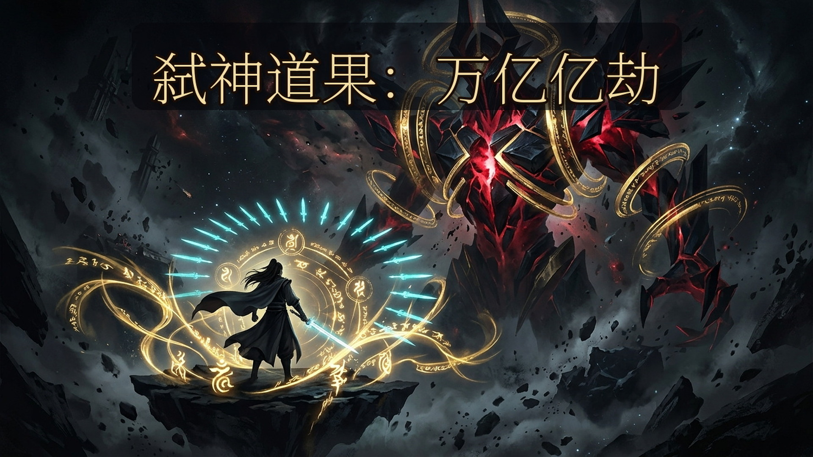

# 弑神道果：万亿亿劫 (Godslayer Dao: Eons of Calamity)



> 修仙 × 克苏鲁题材策略构筑与天文数字增量放置游戏。  
> 觉醒【弑神道胎】，剥离高维天道古神的【灵石】，唤醒五大固定本命护法，点亮千级十重道纹词缀，轰穿十重古神躯壳，在诸天劫数与无尽真神轮回（NG+）中争夺 SSS 瞬杀竞速。

---

## 核心特性

### 1. 大数引擎与精确多乘区演算
- **无限大数支持**：基于 `break_infinity.js` 的 `Decimal` 运算引擎，无缝支持至 `1e9999` 级别数值，自带「中式大数单位（万 → 亿 → 兆 → 京 → …… → 古戈尔）」与「科学计数法」一键切换。
- **20Hz 高精度主循环与 `25次/秒 (0.04s)` 攻击间隔上限**：50ms 逻辑帧驱动手操、机关傀儡自动点击、分身残影、护法独立攻击间隔与每秒腐蚀毒结算。主角傀儡、万法残影与五大护法的**间隔驱动攻击**严格封顶于 **25 次/秒 (`0.04s`)**，超出部分 **1:1 等比例折算为单次攻击伤害倍率**。单次攻击可拆出多段命中（剑气/连击/三才），点击联动与机神充能也会追加攻击事件，因此 HUD 会分别显示“攻击事件/秒”与“命中事件/秒”，不再把两者混为一谈。

### 2. 主角修为、肉身破境与主动神通
- **阶梯线性顿悟**：开局基础攻击 `10`、`+1/击` 起步，结合 500 击心魔软上限与自动傀儡 25% 成长衰减机制，避免前期数值崩坏。
- **肉身破境与 4 大主动神通**：凡胎 → 筑基 → 金丹 → 元婴 → 化神 → 古神道躯，依次解锁【燃血叩击】、【万法残影】、【天罚神雷】、【弑神共鸣】。
- **机关傀儡与后期灵枢自动化**：击破第 1 重躯壳后开放激活与升级（最高 50 级）；随着首通劫三、劫四、劫五、劫六依次解锁自动破境、自动升傀儡、全自动神通、自动顿悟/强技与护法独立自动升级。

### 3. 五大本命护法 × 千级十重道纹 × 48 种词缀协同
- **5 位专精本命护法**（非随机抽卡，定位鲜明、跨角色联动）：
  1. **青冥剑侍**：`0.4s` 极速连斩流（剑影分光 + 御剑随心）
  2. **深渊触母**：永久腐蚀毒与全队暴击毒爆共鸣
  3. **雷火机神**：高爆重炮（剑侍与主角攻击缩减冷却，破壳 6~10 重最终伤害 ×2.25）
  4. **天机阵尊**：聚灵灵石加成 + 1~3 号位增伤光环 + 全队神通减 CD
  5. **混沌古神嗣**：全队总有效等级每满 100 级复利 `×1.18`、汇聚 1~4 号位面板 1000% 且放大全队非复利词缀 `×1.5`
- **1000 级十槽道纹 + ★先天本命神通**：
  - 每位护法于 `Lv.10` 至 `Lv.1000` 逐层解锁 10 个等级词缀槽，每达节点自身面板直接 `×2`（全满 10 槽共 `×1024`）。
  - 38 种等级词缀（五阶品质权重、10 次气运保底、前后 DPS 对比预览、劫二后支持批量锁槽）与 10 种【先天本命神通】（如 ★法天象地、★万剑归宗、★万毒之源、★歼星连射、★千级共鸣）。
  - **词缀石经济**：按【劫数 × 躯壳深度】掉落（劫一每重 `0.4` 颗 → 劫十每重 `2.0` 颗，整数必掉、小数按概率补），洗练按道纹深度阶梯计价（`2 / 4 / 7 / 12`），并新增【道纹淬炼】（`8 / 25 / 70 / 220` 必定提升一阶）作为终局确定性沉淀池，让十槽千级始终是长线目标而非一次点满。

### 4. 六阶 45 件双轨四乘区遗物、平滑十劫与无感自动连刷
- **45 件六阶双轨遗物（四大乘区架构）**：划分为 **凡(8) / 灵(9) / 玄(8) / 圣(7) / 仙(7) / 神(6)** 六大稀有阶，采用 **战力基础池 × 战术终伤池 × 终局复利池 × 经济减抗池** 四大乘区归并，消除前期低层遗物虚高秒杀；通过通关劫数**线性递增掉落（1 → 10 件）**与独立阶位概率获取，其中**【神】阶仅在终焉劫(劫十)以 1% 基础概率极稀掉落**，支持神晶精炼 + 通关劫印双轨叠加。
- **平滑中后期劫数、四大均衡流派与无感自动结算**：劫数四至劫十血量梯度与遗物成长曲线精细配平，保障道海叩击流、高频毒爆流、无限核弹流与千级登神流并驾齐驱；15 秒内达成 **SSS 瞬杀评级** 解锁本劫 **`0.25s` 无感自动连刷**，搭配可开关的【无感自动结算】与同屏飘字/波纹/横幅数量上限，刷宝过程不弹窗打断洗练与强化操作。

### 5. 手机端优先暗黑矢量 UI 与沉浸叙事
- **三幕呼吸式全屏序章**：融合横版封面插画意境分句焦距渐显播放，支持轻触加速与设置中「重温序章」。
- **手机端可收起战区 / 构筑视口**：移动端支持一键【收起构筑】（聚焦古神战区）与【全屏构筑 / 展开战区】（将上方战区折叠为紧凑战斗条，全屏洗练词缀、配装遗物），且主角【灵枢自动修行】支持单手折叠，避免界面挤占重叠。
- **手机端优先触控 × 全局零 Emoji 规范**：全界面采用定制线性 SVG 矢量图腾与 `44px+` 大触控热区卡片，内建全景图鉴查表与洗练前后对比条。
- **离线自动存档 & 12h 离线收益结算**：自动持久化至浏览器 `localStorage`，离开超过 1 分钟重新进入按 **55% 效率（上限 12 小时）** 自动结算离线挂机推进（含灵枢自动修行与毒层渐进叠加）或 SSS 连刷扫荡收获；支持 PWA 一键安装至主屏幕离线直玩、Base64 字符串与 `.json` 备份文件导入导出、五步防误触硬重置及跨设备迁移；内建 Web Audio API 合成打击、神通与破壳音效，序章与设置内置《适龄提示 12+》《健康游戏忠告》及纯单机隐私合规声明。

---

## 技术栈

- **前端框架**：React 19 + TypeScript + Vite 8
- **样式与动效**：Tailwind CSS v4 (`@tailwindcss/vite`) + 原生 CSS 关键帧动画 + 国内系统高可读字体栈（零外部字体请求）
- **大数计算**：`break_infinity.js`
- **离线 PWA**：`vite-plugin-pwa` (`Workbox` 自动资源预缓存与 Web App Manifest)
- **图标库**：`lucide-react` + 定制线性 SVG 组件
- **持久化与音效**：`localStorage` (Base64 / `.json` 文件导出导入) + Web Audio API 合成音效引擎

---

## 项目目录结构

```text
.
├── docs/                       # 完整游戏设计文档中心 (v4.1)
│   ├── 00_PROJECT_MAP.md       # 文档导航与代码模块映射
│   ├── 01_GLOSSARY_AND_UI.md   # 核心名词字典、重开传承规则与 UI 布局规范
│   ├── 02_MATH_AND_ECONOMY.md  # 全局伤害乘区、25/s 攻击间隔溢出、毒伤与经济公式
│   ├── 03_HERO_AND_AUTOMATION.md   # 主角成长、肉身破境、神通、傀儡与后期自动化
│   ├── 04_MERCENARY_AND_AFFIXES.md # 五大护法、千级十槽与 48 种词缀配置表
│   ├── 05_RELICS_SYSTEM.md     # 六阶 45 件古神遗物配置表（双轨/流光/掉宝/溢转）
│   ├── 06_BOSS_AND_ENDGAME.md  # 10 重躯壳、10 大劫数独立掉率、无感连刷与 NG+
│   ├── 07_VISUAL_AND_UX_GUIDE.md   # 暗黑矢量视觉规范、弹窗并发上限与洗练预览
│   ├── 08_ONBOARDING_AND_LORE.md   # 世界观序章、引导节点与流派指南
│   └── TAPTAP_RELEASE_GUIDE.md     # TapTap 上架简介、标签、商店图集与打包指南
├── public/
│   ├── apple-touch-icon.png    # iOS 添加到主屏幕图标 (180x180)
│   ├── pwa-192x192.png         # PWA 标准图标 (192x192)
│   ├── pwa-512x512.png         # PWA 高清图标 (512x512)
│   ├── pwa-maskable-512x512.png # PWA 安全区遮罩图标 (512x512)
│   └── taptap/                 # 运行时引用的 TapTap 视觉素材
│       ├── icon-1x1.jpg        # 1:1 游戏图标（满幅、无圆角）
│       ├── cover-16x9.jpg      # 16:9 横版宣传图 / OG 分享封面
│       └── poster-3x4.jpg      # 3:4 竖版推荐海报
├── taptap-assets/              # 仅用于后台上传的成片（不进入包体）
│   ├── screenshots/            # 4 张 1290×2796 实机截图
│   ├── video/                  # 720×1280 9:16 H.264 实机录屏
│   ├── promo-square-1440.jpg   # 1440×1440 方形宣传图
│   └── README.md               # 物料与后台上传字段对照
├── src/
│   ├── assets/images/          # 构建打包内嵌高清插画资源
│   ├── components/             # UI 组件 (Arena, Tabs, Modals, Compendium, PWAInstallButton, OfflineIndicator, SVG Icons)
│   ├── config/                 # 数值与配置词库 (affixes, archetypes, bosses, relics, highlights)
│   ├── core/                   # 伤害公式引擎与大数格式化 (damageCalc, formatNumber)
│   ├── hooks/                  # React 自定义 Hook (usePWAInstall)
│   ├── stores/                 # 全局游戏状态、主循环、离线结算与存档系统 (useGameStore)
│   ├── types/                  # TypeScript 领域类型定义
│   ├── utils/                  # Web Audio 合成音效工具
│   ├── App.tsx                 # 三段式主壳体与战区/构筑展开收起控制
│   ├── index.css               # 全局暗黑主题、系统字体栈、流光特效与关键帧动效
│   └── main.tsx                # 应用入口
├── CHANGELOG.md                # 版本更新日志
├── LICENSE                     # MIT 开源协议
├── index.html                  # HTML 入口、OG/Twitter 分享卡与图标声明
├── metadata.json               # 应用元信息
├── package.json                # 依赖与脚本配置
├── tsconfig.json               # TypeScript 编译配置
└── vite.config.ts              # Vite + VitePWA 构建配置
```

---

## TapTap 上架美术套件与商店指南

TapTap 小游戏物料已按 2026 年审核规范制作：图标去圆角、宣传图带游戏名、截图 ≥1280×720、录屏 720×1280 9:16。后台上传文件在 [`taptap-assets/`](./taptap-assets/)，详细资质、文案、打包与提审步骤见 [**《TapTap 上架指南》**](./docs/TAPTAP_RELEASE_GUIDE.md)：

| 物料 | 文件路径 | 规格 |
| :--- | :--- | :--- |
| 游戏图标 | [`taptap-assets/icon-1x1.jpg`](./taptap-assets/icon-1x1.jpg) | 1024×1024，满幅方形 |
| 横版宣传图 | [`taptap-assets/cover-16x9.jpg`](./taptap-assets/cover-16x9.jpg) | 1920×1080，含游戏名 |
| 方形宣传图 | [`taptap-assets/promo-square-1440.jpg`](./taptap-assets/promo-square-1440.jpg) | 1440×1440，含游戏名 |
| 实机截图 | [`taptap-assets/screenshots/`](./taptap-assets/screenshots/) | 1290×2796，4 张 |
| 实机录屏 | [`taptap-assets/video/gameplay-9x16.mp4`](./taptap-assets/video/gameplay-9x16.mp4) | 720×1280，H.264，17.3s |

---

## 本地开发与构建

### 环境要求
- Node.js >= 20（Vite 8 要求）或 Bun >= 1.4（与 CI 一致，推荐）
- 包管理器：Bun（仓库使用 `bun.lock`，CI 固定 `bun 1.4.4`）；npm / pnpm 亦可运行

### 安装与运行

```bash
# 1. 安装依赖
bun install

# 2. 启动本地开发服务器 (默认端口 3000)
bun run dev

# 3. TypeScript 静态类型检查
bun run lint

# 4. 生产环境打包构建（Web / PWA）
bun run build

# 5. TapTap 小游戏构建（相对路径、关闭 Service Worker）
bun run build:minigame

# 6. 预览小游戏构建产物
bun run preview:minigame

# 7. 数值回归：改伤害 / 经济公式后必跑
bun run damage:sim     # 伤害来源、攻击/命中口径、HUD/离线一致性、乘区消融
bun run econ:check     # 词缀石期望、掉率区间、洗练/淬炼定价
bun run balance:audit  # 词缀/遗物边际审计、伤害归因与平衡门槛
```

> 注：本项目在 Windows 下构建时若遇到系统 Temp 目录 `EPERM`，可把 `TEMP` / `TMP` 指向项目内临时目录后重跑 `bun run build`；这是环境权限问题，不是代码错误。

---

## TapTap 小游戏接入

- 平台适配层：`src/platform/tap.ts`（登录、云存档、激励/插屏广告、添加到桌面、生命周期）。
- 隐私授权：`src/components/PrivacyConsent.tsx`，小游戏内优先走 `tap.requirePrivacyAuthorize`。
- 云存档：本地存档后 65s 节流上传，首启无本地档时自动恢复；设置页可手动上传/恢复。
- 广告位：在 `.env.minigame` 填 `VITE_TAPTAP_REWARDED_AD_UNIT_ID` 与 `VITE_TAPTAP_INTERSTITIAL_AD_UNIT_ID`；未配置时正式包不展示广告。
- 小游戏包：`bun run build:minigame` 生成 `dist-minigame/`，用 TapTap 打包工具生成 zip 上传。
- 无版号、零内购；广告仅走 Dirichlet（TapADN）聚合。

---

## GitHub Pages 在线游玩部署

仓库已内置 [`.github/workflows/deploy.yml`](./.github/workflows/deploy.yml) 与自适应 `base` 路径配置（[`vite.config.ts`](./vite.config.ts)），推送至 GitHub 即可零配置自动发布并直接在电脑或手机浏览器中在线游玩（本地 `localStorage` 自动存档，支持 Base64 导出迁移）：

1. 将本仓库代码推送到 GitHub 的 `main` 或 `master` 分支。
2. 进入 GitHub 仓库页 **Settings → Pages**。
3. 在 **Build and deployment → Source** 下拉框中选择 **GitHub Actions**。
4. 等待 Actions 中的 **Deploy to GitHub Pages** 工作流运行完成（约 1 分钟），即可通过页面生成的 `https://<你的用户名>.github.io/<仓库名>/` 链接直接游玩。
5. 若使用自定义根域名或手动上传静态产物，亦可通过 `VITE_BASE_PATH=/ npm run build` 自定义基础路径。

---

## 设计文档索引

完整数值平衡、公式推导、词缀/遗物配置表均归档于 [`docs/`](./docs/00_PROJECT_MAP.md) 目录：

- [00. 项目知识库地图](./docs/00_PROJECT_MAP.md)
- [01. 全局名词解析与 UI 规范](./docs/01_GLOSSARY_AND_UI.md)
- [02. 核心数学公式与全局伤害计算器](./docs/02_MATH_AND_ECONOMY.md)
- [03. 主角成长体系与主动神通](./docs/03_HERO_AND_AUTOMATION.md)
- [04. 五大固定本命佣兵与 48 词缀全表](./docs/04_MERCENARY_AND_AFFIXES.md)
- [05. 局外 45 件六阶遗物系统](./docs/05_RELICS_SYSTEM.md)
- [06. BOSS 10 重躯壳与 10 大劫数独立掉宝](./docs/06_BOSS_AND_ENDGAME.md)
- [07. 视觉与交互规范](./docs/07_VISUAL_AND_UX_GUIDE.md)
- [08. 世界观序章与新手引导](./docs/08_ONBOARDING_AND_LORE.md)

---

## 开源协议

本项目基于 [MIT License](./LICENSE) 开源。
